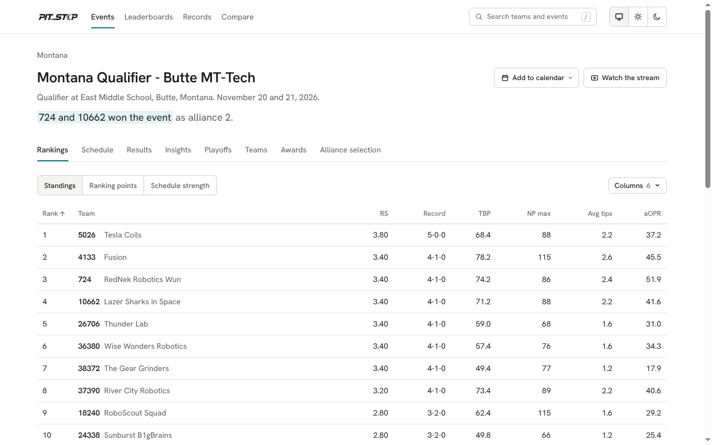
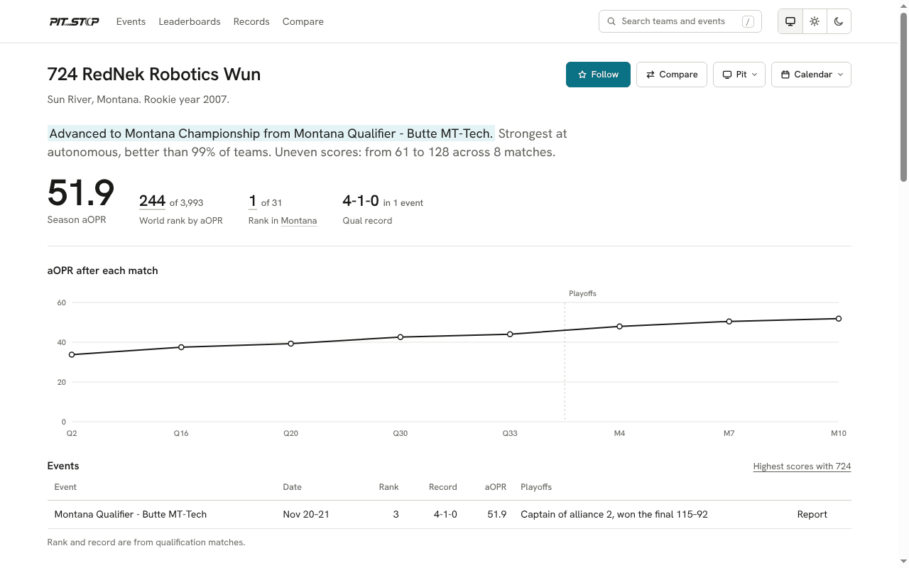
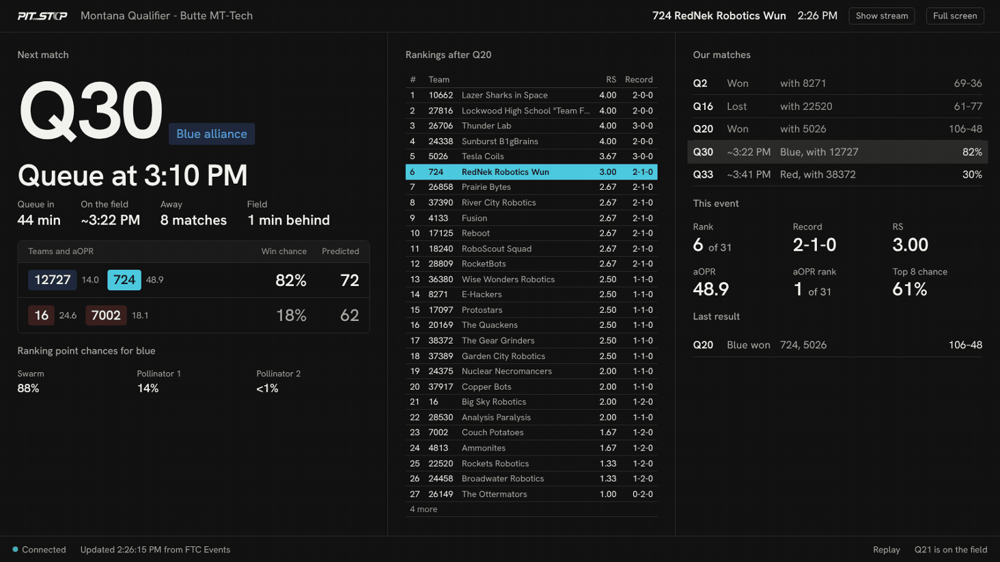

# PitStop

[](https://www.ftcpitstop.com)


PitStop is a stats and pit tools site for the FIRST Tech Challenge (FTC) 2026-27 BIOBUZZ season.
It is live at https://www.ftcpitstop.com. It is not affiliated with or endorsed by FIRST.



## What it does

- **Events:** rankings, schedule, results, playoffs, alliance selection, awards, insights, match
  pages, team reports, a scouting binder, and CSV and .ics exports.
- **Teams:** season stats, an aOPR chart, events, awards, partners and opponents, and badges.
- **Lists:** leaderboards, records, regions, advancement and event strength.
- **Tools:** compare up to four teams, a match simulator and a prediction accuracy page.
- **Pit views:** a phone view at `/NUMBER` and a TV display at `/NUMBER/tv`.
- **Team workspace:** `/w` has a shared pick list, battery log, checklist and strategy board, with
  join codes and offline edits.

Ratings use aOPR (adjusted OPR). The About page (`/about`) explains the method, and
`scripts/backtest/RESULTS.md` has the backtest behind it.

## Screenshots

A team page, with season aOPR, world and region rank, and aOPR after each match:



The TV pit display in replay mode (`/724/tv?replay=1&at=Q20`):



## Team badges

Teams can put a live PitStop badge on their website or README. Each team page has the snippets
under "Badges for a team website or README". For example:

[](https://www.ftcpitstop.com/teams/724)

```md
[](https://www.ftcpitstop.com/teams/724)
```

Add `?stat=opr`, `rank`, `region`, `record` or `next` for one stat, `?theme=dark` for the dark
version, or use `/badge/NUMBER/card.svg` for a larger card.

## Stack

- SvelteKit 3 with Svelte 5 runes, remote functions and TypeScript
- `@sveltejs/adapter-vercel` on the Node 24 runtime, hosted on Vercel
- Upstash Redis for the data cache and workspaces
- Vitest with jsdom for tests
- Scoped CSS with tokens in `src/lib/styles`, and the Hanken Grotesk font
- satori and resvg for social preview images

Data comes from the FIRST FTC Events API, the FTCScout GraphQL API and Nexus (queue status).

## Run it locally

You need Node 24 or later. `.npmrc` sets `engine-strict`, so older versions stop the install.

```sh
npm ci
npm run dev
```

Put environment variables in `.env.local` in the repo root. Git ignores it. All of them are
optional and are declared in `src/env.ts`.

- `FTC_USERNAME` and `FTC_API_KEY`: FTC Events API credentials. Without them, requests to the FTC
  Events API fail.
- `NEXUS_API_KEY`: Nexus API key for queue status.
- `KV_REST_API_URL` and `KV_REST_API_TOKEN`: Upstash Redis REST URL and token, as the Vercel
  integration sets them. `UPSTASH_REDIS_REST_URL` and `UPSTASH_REDIS_REST_TOKEN` also work and take
  priority. Without Redis, the cache is off and workspaces are turned off.

If `.env.local` points at the production Redis store, the dev server writes to production. Do not
create test workspaces there, and never flush or bulk delete keys, because the store is shared.

## Scripts

- `npm run dev`: start the dev server
- `npm run build`: make a production build
- `npm run preview`: serve the production build
- `npm run check`: type check with svelte-check
- `npm run lint`: Prettier check and ESLint
- `npm run format`: format with Prettier
- `npm test`: run all tests once
- `npm run test:unit`: run tests in watch mode
- `npm run coverage`: run tests with coverage
- `npm run budget`: build, then check that shared JavaScript stays under 60 kB and shared CSS
  under 6.8 kB, both gzipped

Before a merge or deploy, `npm run check`, `npm run lint`, `npm test` and `npm run build` must all
pass.

## Project layout

- `src/routes/(app)`: the main site pages
- `src/routes/(bare)`: the pit phone and TV views
- `src/routes/api`, `badge`, `og`, `sitemap.xml`: JSON endpoints, SVG badges, preview images and
  the sitemap
- `src/lib/server`: FTC Events, FTCScout and Nexus clients, the Redis cache, cache headers and CSP
- `src/lib/model`: aOPR, predictions, ranking points and the simulator
- `src/lib/game`: BIOBUZZ game rules and match replay
- `src/lib/analysis`: season and event stats
- `src/lib/components`, `src/lib/ui`, `src/lib/styles`: UI
- `src/lib/workspace`: the team workspace
- `src/service-worker.ts`: offline support for pit and workspace pages
- `tests`: data, budget, resilience and bundle tests, with fixtures
- `scripts/audit`: checks PitStop numbers against FIRST and FTCScout (see `AUDIT.md`)
- `scripts/backtest`: the rating model backtest

## Caching

Caching uses CDN `Cache-Control` headers only, from the presets in `src/lib/server/http.ts`. Do not
add ISR. `tests/data/caching.test.ts` fails if it shows up.

## Deploy

Vercel builds from git. Work goes on `rewrite`, and `main` is production. To deploy, push
`rewrite`, then fast-forward `main` to it:

```sh
git push origin rewrite && git push origin rewrite:main
```
